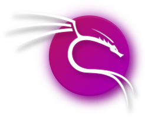

## Overview

Labs are entirely built on virtual machines running on [VMware Workstation Pro](https://www.vmware.com/products/desktop-hypervisor/workstation-and-fusion).

## Virtual Machines

| Icon | OS | Description |
|:---:|---|---|
|  | [Kali Purple](https://www.kali.org/get-kali/#kali-platforms) | Tool suite for pentesting |

## Pentesting Tools

- nmap
